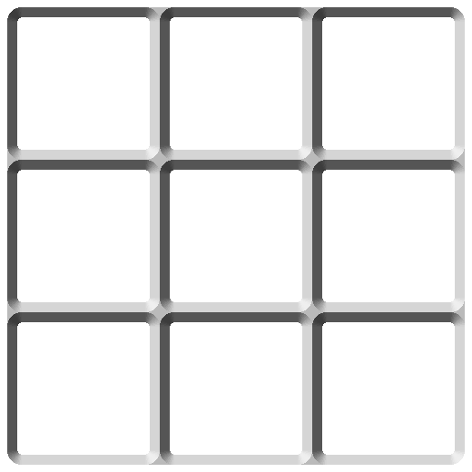

# Gridfinity Baseplate Generator (STL) – Free Python Script for 3D Printing

A free, open-source **Gridfinity baseplate generator** written in plain Python.
Pick the number of columns and rows, run one command, and get a print-ready
**Gridfinity baseplate STL** at the standard 42 mm grid size. No CAD software,
no OpenSCAD, no Fusion 360, and no Python packages to install.

Works with any slicer (Bambu Studio, OrcaSlicer, PrusaSlicer, Cura) and any
FDM 3D printer, including the **Bambu Lab A1 mini**, A1, P1S, X1C, Prusa MK4
and Ender 3.



## Features

- **Standard Gridfinity dimensions**: 42 × 42 mm grid cells, 4.65 mm socket
  profile, 4 mm corner radius. Bins from any standard Gridfinity design fit.
- **Any size**: 1x1, 2x3, 3x3, 4x4, 5x5 or any custom grid.
- **Open-frame (lite) baseplate**: fast to print, uses little filament,
  needs no supports.
- **Clean, watertight mesh**: every generated STL is checked for open or
  mismatched edges, and the result is printed (`bad edges 0`), so slicers
  have nothing to repair. Automated tests check this on every change.
- **Zero dependencies**: needs only Python 3.9 or newer. Tested on Windows,
  macOS and Linux.

## Quick start

```bash
git clone https://github.com/spudstr/gridfinity-baseplate-generator.git
cd gridfinity-baseplate-generator
python make_baseplate.py 3 3
```

On Windows, use `py` instead of `python`. The STL is saved to
`output/gridfinity_baseplate_3x3.stl`.

### Usage

```
python make_baseplate.py [columns] [rows] [output.stl] [--cell SIZE]
```

| Example | Result |
|---|---|
| `python make_baseplate.py` | 3x3 baseplate in `output/` |
| `python make_baseplate.py 4 4` | 4x4 baseplate in `output/` |
| `python make_baseplate.py 2 5 drawer.stl` | 2x5 baseplate saved as `drawer.stl` |
| `python make_baseplate.py 3 3 --cell 2in` | 3x3 baseplate with 2 in (50.8 mm) cells |
| `python make_baseplate.py --help` | Show all options |

### Custom cell size

`--cell` changes the grid cell size. It defaults to the **standard 42 mm
Gridfinity grid**, so you only need it for a custom or imperial grid. It
accepts millimetres (`--cell 50`) or inches (`--cell 2in`). Non-standard
files get the cell size in their name, e.g.
`gridfinity_baseplate_3x3_50.8mm-cell.stl`.

Only 42 mm cells fit standard Gridfinity bins. A custom cell size keeps the
standard Gridfinity socket profile, so it suits bins you design to match.
It will not necessarily fit bins from other "Gridfinity-inspired" systems.

The script prints the file path, the final size in mm, and the mesh check
result (`bad edges 0` means the mesh is watertight).

## Gridfinity size chart

Gridfinity uses a **42 mm grid**. Baseplates are exactly 42 mm per cell. Bins
are 0.5 mm smaller so they drop in easily. Bin heights count in 7 mm units.

| Cells | Baseplate size | Bin size |
|---|---|---|
| 1 | 42 mm | 41.5 mm |
| 2 | 84 mm | 83.5 mm |
| 3 | 126 mm | 125.5 mm |
| 4 | 168 mm | 167.5 mm |
| 5 | 210 mm | 209.5 mm |
| 6 | 252 mm | 251.5 mm |

**Baseplate socket profile** (top to bottom): 2.15 mm chamfer at 45°, 1.8 mm
vertical wall, 0.7 mm chamfer at 45°, 4.65 mm deep in total.

## Largest baseplate per printer

| Printer | Bed size | Largest single baseplate |
|---|---|---|
| Bambu Lab A1 mini | 180 × 180 mm | 4x4 |
| Prusa MINI+ | 180 × 180 mm | 4x4 |
| Ender 3 / V2 / V3 | 220 × 220 mm | 5x5 |
| Bambu Lab A1, P1S, X1C | 256 × 256 mm | 6x6 |
| Prusa MK4 / MK3S | 250 × 210 mm | 5x4 |

These leave a little margin. A plate exactly as big as the bed (for
example 5 cells, 210 mm, on a 210 mm axis) usually won't print, because
slicers keep the edge of the bed clear. For a bigger drawer, print several
baseplates and set them side by side.

## Printing tips

- Print flat on the bed with **no supports**.
- PLA or PETG, 0.2 mm layers, 2–3 walls. Infill barely matters because the
  open-frame plate is mostly walls.
- The open-frame baseplate flexes on its own but goes rigid once it is in a
  drawer or glued to a board.

## Troubleshooting: "my Gridfinity bins don't fit"

If bins are loose, or span the wrong number of sockets, check that the bins
and the baseplate use the same grid. Some Gridfinity-inspired systems use a
2 in (50.8 mm) cell, which does not fit standard 42 mm bins. Measure a 1-cell
bin: a standard Gridfinity bin is 41.5 mm wide.

## Output folder

Generated STL files go in `output/`. The 3x3 and 4x4 baseplates are already
included, ready to download and print.

## Contributing and security

Bug reports, ideas and pull requests are welcome. See
[CONTRIBUTING.md](CONTRIBUTING.md). To report a security issue privately,
see [SECURITY.md](SECURITY.md).

## License

[MIT](LICENSE). Free to use, modify and share, including for commercial
use. The generated STL files are yours to print, sell or remix.

## Credits and disclosures

Gridfinity is the modular storage system created by
[Zack Freedman](https://www.youtube.com/c/ZackFreedman) and released under
the MIT license. This repository is an **independent, unofficial** baseplate
generator that follows the published Gridfinity dimensions. It is not
affiliated with or endorsed by Zack Freedman or Voidstar Lab, and it
contains no files from the original Gridfinity release.

See [NOTICE.md](NOTICE.md) for full attribution, licensing notes and
disclosures.

---

**Keywords:** gridfinity, gridfinity baseplate, gridfinity generator,
gridfinity STL, gridfinity python, parametric gridfinity, 42mm grid,
3D printing, 3D printable storage, drawer organizer, tool organizer,
Bambu Lab A1 mini gridfinity, STL generator
